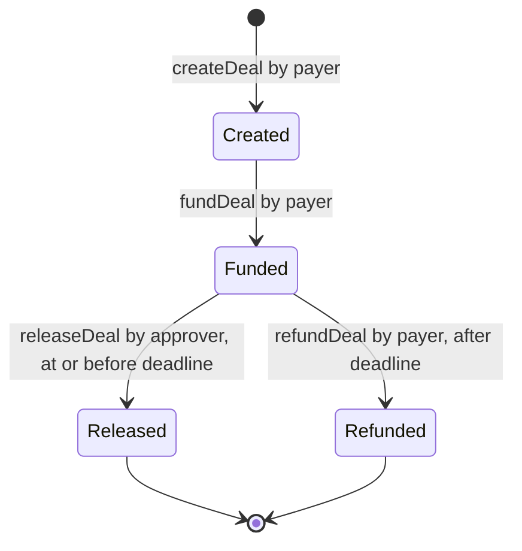
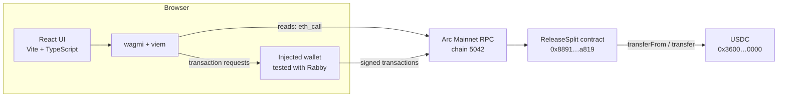

# ReleaseSplit

**Conditional USDC Escrow & Multi-Recipient Payments on Arc**

ReleaseSplit lets a payer lock USDC in an onchain escrow, name an independent approver, and fix how the payment will be split between two or three recipients. The approver can release the funds to every recipient in one transaction before a deadline. If the deadline passes without a release, only the payer can take the funds back.

**[Live app](https://releasesplit.vercel.app/)** · **[Contract on Arc Explorer](https://explorer.arc.io/address/0x8891521e3eb78a900e0664e802fb6549b4b4a819)** · **[Example release transaction](https://explorer.arc.io/tx/0xf2f57d37125cb5626893ffe0bf78dd366eb68e1511469289b441ea9e941c69d1)**

---

## Contents

- [Overview](#overview)
- [Live Demo](#live-demo)
- [Core Features](#core-features)
- [How It Works](#how-it-works)
- [Real-World Use Cases](#real-world-use-cases)
- [Arc Mainnet Deployment](#arc-mainnet-deployment)
- [Verified Mainnet Demonstration](#verified-mainnet-demonstration)
- [Technical Architecture](#technical-architecture)
- [Built with Arc Studio](#built-with-arc-studio)
- [Local Development](#local-development)
- [Security and Limitations](#security-and-limitations)
- [Hackathon Information](#hackathon-information)
- [Future Possibilities](#future-possibilities)

---

## Overview

Paying several people for shared work usually depends on trust in one direction or the other. If the payer pays upfront, they have no recourse when the work is not accepted. If the recipients wait, they have no assurance that the money exists. Splitting one payment between several people adds manual transfers and room for error.

ReleaseSplit moves that coordination into a smart contract on Arc:

- **The payer** creates a deal and deposits the full amount in USDC. From then on, the funds are held by the contract, not by any person.
- **The approver**, a separate address chosen by the payer, is the only party who can release the funds, and only until the deadline.
- **The recipients** receive their fixed shares automatically, all in the same release transaction.
- **The deadline** is the fallback. If no release happens in time, the payer can reclaim the full amount.

The terms of a deal cannot be changed after it is created, and the contract has no owner, admin functions, fees, or upgrade mechanism. The only ways funds can leave a deal are a release to its recipients or a refund to its payer.

## Live Demo

### ➜ [releasesplit.vercel.app](https://releasesplit.vercel.app/)

The app is connected to the ReleaseSplit contract on **Arc Mainnet**. Every action is a real transaction that moves real USDC and costs a small network fee, which on Arc is paid in USDC. You will need a browser wallet (tested with [Rabby](https://rabby.io/)) holding USDC on Arc Mainnet. Anyone can browse existing deals without connecting a wallet.

## Core Features

| Feature | What is implemented |
|---|---|
| **Onchain USDC escrow** | `fundDeal` transfers the deal amount from the payer into the contract, which holds it until a release or refund. |
| **Independent approver authorization** | The approver must be a different address from the payer, and only the approver can call `releaseDeal`. |
| **Multi-recipient payment splitting** | 2 or 3 recipients with fixed shares in basis points (they must add up to 100%). One release pays all of them in a single transaction. |
| **Deadline-based payer refunds** | After the deadline, the approver can no longer release and only the payer can call `refundDeal`, which returns the full amount. |
| **Transparent verification** | Every deal's terms and state can be read onchain with `getDeal`. The app lists all deals and links each transaction to Arc Explorer. |
| **Wallet integration** | Connects through wagmi's injected-wallet connector with a ConnectKit UI, prompts a switch to Arc Mainnet, and was tested end to end with Rabby. |
| **Gas-aware "Max" amount** | Because Arc's gas token is USDC, the Max button keeps enough USDC back to pay for the create, approve, and deposit transactions. |
| **Arc Mainnet deployment** | Live at [`0x8891…a819`](https://explorer.arc.io/address/0x8891521e3eb78a900e0664e802fb6549b4b4a819) on chain 5042. |

## How It Works

```
Payer creates a deal          terms fixed: approver, recipients + shares, amount, deadline
        ↓
Payer approves USDC           ERC-20 allowance for the escrow contract
and deposits it               fundDeal moves the USDC into the contract
        ↓
Funds stay in the contract    no one can redirect them
        ↓
Approver releases payment     only the approver, only at or before the deadline
        ↓
USDC is sent to every recipient in one transaction

Alternative: the deadline passes without a release → only the payer can claim a refund
```



### Who can do what

| Step | Who | Condition enforced by the contract | Effect |
|---|---|---|---|
| `createDeal` | Payer (any address) | 2–3 distinct recipients, shares add up to 10,000 basis points, amount > 0, deadline in the future | Stores the terms. **No funds move.** |
| USDC `approve` | Payer | Standard ERC-20 allowance on the USDC token | Allows the escrow to pull the deposit. **No funds move.** |
| `fundDeal` | Payer only | Deal is in the `Created` state | Full amount moves from the payer to the escrow contract. |
| `releaseDeal` | Approver only | Deal is `Funded` and the deadline has not passed | Escrow pays every recipient their share. |
| `refundDeal` | Payer only | Deal is `Funded` and the deadline has passed | Escrow returns the full amount to the payer. |

> **Two different "approvals".** The USDC `approve` step is the payer's token allowance, which only makes the deposit possible. The **approver** is a separate role: the address that authorizes the release of escrowed funds to the recipients. Approving USDC does not release anything, and the approver cannot deposit, refund, or change where the funds go.

**Split math.** Each recipient after the first receives `amount × share / 10,000`. The first recipient receives the remainder, so rounding dust is never left in the contract and the payouts always add up to the deposited amount.

**Address rules.** The approver cannot be the payer. Recipients must be distinct, non-zero, and different from both the payer and the approver.

In the app, the **New Deal** form walks the payer through all three transactions (create, approve USDC, deposit). **All Deals** shows every deal onchain, and **Deal Detail** shows only the actions the connected wallet is allowed to take.

## Real-World Use Cases

These are potential applications of the current contract, not existing customer deployments.

- **Freelancer and contractor payments.** A client escrows the fee for a job, a project lead or neutral third party acts as approver, and the payment is split between a freelancer and a subcontractor when the work is accepted.
- **Revenue sharing between collaborators.** Two or three collaborators agree on fixed percentages upfront, and one approved release pays everyone at once.
- **Milestone-approved service payments.** A deal covers one milestone. The deadline guarantees that the payer gets the money back if the milestone is never approved.
- **Small team or project payouts.** A bounty or grant payout is split between up to three team members, with a reviewer acting as approver.

Each deal supports one release, 2–3 recipients, and a single deadline.

## Arc Mainnet Deployment

| | |
|---|---|
| Network | Arc Mainnet, chain ID **5042** |
| ReleaseSplit contract | [`0x8891521e3eb78a900e0664e802fb6549b4b4a819`](https://explorer.arc.io/address/0x8891521e3eb78a900e0664e802fb6549b4b4a819) |
| Deployment transaction | [`0x6b57b351c71175e121006b4c828318df07f9caa6b2f4ae8a7928095ab6d49db6`](https://explorer.arc.io/tx/0x6b57b351c71175e121006b4c828318df07f9caa6b2f4ae8a7928095ab6d49db6) (block 27,261,403, 2026-10-22 09:24 UTC) |
| Deployer | `0x72043b08c4e865b9eb6712e80ef2780a5648af9f` (Rabby wallet) |
| USDC (ERC-20 interface, 6 decimals) | [`0x3600000000000000000000000000000000000000`](https://explorer.arc.io/token/0x3600000000000000000000000000000000000000) |
| Native gas token | USDC (18-decimal native balance; the same funds as the ERC-20 view) |
| Constructor arguments | None. The USDC address is a constant in the contract. |
| Source verification on Arc Explorer | Not submitted yet. The deployed bytecode can be checked against the committed build artifact as shown below. |

The mainnet contract runs the same bytecode that was tested on Arc Testnet ([`0x9472…fe71`](https://explorer.testnet.arc.io/address/0x9472cf2e3cf010430f3daf84d71adec5d5f3fe71)). It was deployed from a Rabby wallet with the local page in [`deploy/mainnet/`](deploy/mainnet/), which sends the committed artifact unchanged after checking its SHA-256 hash. To verify the deployment yourself (read-only, no wallet needed):

```bash
node deploy/mainnet/verify.mjs 0x6b57b351c71175e121006b4c828318df07f9caa6b2f4ae8a7928095ab6d49db6
```

The script confirms that the transaction succeeded and was a plain contract creation with no value sent. It also checks that the deploy data and the onchain runtime bytecode match [`contracts/out/ReleaseSplit.sol/ReleaseSplit.json`](contracts/out/ReleaseSplit.sol/ReleaseSplit.json), and that `usdcAddress()` returns the Arc USDC address.

> The script was written to run right after deployment, so its last check expects `dealCount() = 0`. Deals have been created since then, so it now reports that one check as **FAIL**. Every bytecode and configuration check still passes.

## Verified Mainnet Demonstration

The full lifecycle was tested on Arc Mainnet with real USDC: four deals of **0.10 USDC** each, split **50% / 50%** between two recipient wallets. The approver was a separate wallet from the payer. All transactions below succeeded and can be checked on Arc Explorer. The escrow contract's USDC balance afterwards is zero.

| Deal | Outcome | Create | Deposit | Final action |
|---|---|---|---|---|
| #0 | Refunded to payer after the deadline | [`0x610f…6022`](https://explorer.arc.io/tx/0x610f8bb9d5880af53a000ffed79b53000ad5089c52158eaae0e3fafb03576022) | [`0x6e9d…7b96`](https://explorer.arc.io/tx/0x6e9d55be0568e8a6a9ec1fab3e6d705b9ddc2f8af6259a5c009d9e3bc6017b96) | Refund [`0xc4dd…59f4`](https://explorer.arc.io/tx/0xc4dd0893d0e4b34fd2395a974ff5136bc8572026fff57308f2fcd115d8be59f4) |
| #1 | Refunded to payer after the deadline | [`0x034a…212a`](https://explorer.arc.io/tx/0x034a266204869228d314eaced21de5a511bf88349472e514bd4386ae09bc212a) | [`0x972d…1c1a`](https://explorer.arc.io/tx/0x972d80c2d381f167397ee3381e9f56195eeb10e683ba97095db6f032751b0c1a) | Refund [`0x7df2…d5d9`](https://explorer.arc.io/tx/0x7df2b5207b0e390b92220309cd6ebec888d82bf3f071947a522e029aa9abd5d9) |
| #2 | Refunded to payer after the deadline | [`0xfff2…e3d9`](https://explorer.arc.io/tx/0xfff2a11e6d12649861d4f3aa22085c40dcc2a439a60fb1cdbacbf37dad6be3d9) | [`0x6d24…431c`](https://explorer.arc.io/tx/0x6d2435e74a2e0249cfef83ec3eb18e8a0bb247ac8bd9a4a0fb16e9b2fa57431c) | Refund [`0x25a0…0601`](https://explorer.arc.io/tx/0x25a0e757c6eb995383534cf0abdf96cc3a8b06d7911e7fa531fb70e09d840601) |
| **#3** | **Released by the approver to both recipients** | [`0xc5b3…b7b2`](https://explorer.arc.io/tx/0xc5b3e19de9d5a64226bc9c8e03a63da796f04fd256d41f4355fa6dc1f9b8b7b2) | [`0x7bc0…af2b`](https://explorer.arc.io/tx/0x7bc0ff123efeae98e5777f96285bd64116c7e1ace36c3c4c4c89578bf077af2b) | **Release [`0xf2f5…69d1`](https://explorer.arc.io/tx/0xf2f57d37125cb5626893ffe0bf78dd366eb68e1511469289b441ea9e941c69d1)** |

### Deal #3: independent approver release

- **Release transaction:** [`0xf2f57d37125cb5626893ffe0bf78dd366eb68e1511469289b441ea9e941c69d1`](https://explorer.arc.io/tx/0xf2f57d37125cb5626893ffe0bf78dd366eb68e1511469289b441ea9e941c69d1) (2026-10-22 20:43 UTC, about seven minutes before the deal's deadline)
- **Sent by the approver** `0xd0D4…233F`, a different wallet from the payer `0x7204…af9f`
- **Distribution:** two USDC transfers of **0.05 USDC** each from the escrow contract to `0xbDc9…dBe3` and `0xcF97…478c`. The recipients' balances were also checked in Rabby.
- **Deal state afterwards:** `Released`

### Network fees observed

Fees on Arc are paid in USDC and vary with network conditions. In the tests above, each step cost about:

| Transaction | Fee paid (USDC) |
|---|---|
| Contract deployment | 0.0176 |
| `createDeal` (2 recipients) | 0.0044 – 0.0050 |
| `fundDeal` | 0.0016 – 0.0018 |
| `releaseDeal` (2 recipients) | 0.0029 |
| `refundDeal` | 0.0014 – 0.0016 |

## Technical Architecture



There is no backend, database, or indexer. The app reads everything directly from the contract over Arc's public RPC, and every write is a transaction signed in the user's wallet.

### Smart contract

[`contracts/ReleaseSplit.sol`](contracts/ReleaseSplit.sol)

- Solidity, compiled with solc **0.8.28** (optimizer 200 runs, EVM `paris`) using Foundry.
- OpenZeppelin Contracts **5.1.0**: `SafeERC20` for token transfers and `ReentrancyGuard` on `releaseDeal` and `refundDeal`.
- Each deal stores the payer, approver, up to three recipients with `uint16` basis-point shares, the amount (USDC, 6 decimals), the deadline, and its state (`Created → Funded → Released | Refunded`).
- Public API: `createDeal`, `fundDeal`, `releaseDeal`, `refundDeal`, `getDeal`, `dealCount`, `usdcAddress`.
- Custom errors (`NotPayer`, `NotApprover`, `WrongState`, `DeadlinePassed`, `DeadlineNotPassed`, `InvalidBps`, and others). The app translates them into readable messages.
- Events: `DealCreated`, `DealFunded`, `DealReleased`, `DealRefunded`.
- Tests: [`contracts/test/ReleaseSplit.t.sol`](contracts/test/ReleaseSplit.t.sol) contains 38 unit tests, 4 fuzz tests, and 2 invariant tests (for example, that the contract holds no USDC after a release).

### Frontend

- **React 18**, **TypeScript**, **Vite 6**, and **Tailwind CSS**.
- **wagmi 2** and **viem 2** for contract reads, writes, and receipts. The chain is viem's built-in `arc` definition (chain 5042, `https://rpc.mainnet.arc.io`).
- **ConnectKit** for the wallet UI, on top of wagmi's `injected()` connector.
- A transaction is reported as successful only after its receipt is confirmed. Reverted or unconfirmed transactions show an error with an explorer link.

### Repository layout

```
contracts/
  ReleaseSplit.sol                  escrow contract
  test/ReleaseSplit.t.sol           Foundry unit, fuzz and invariant tests
  out/ReleaseSplit.sol/             compiled artifact (ABI + the bytecode deployed on mainnet)
  contract-metadata/                Arc Studio's Arc Testnet deployment record
deploy/mainnet/                     Rabby deploy page and read-only verification script
src/
  App.tsx                           views: landing, all deals, new deal, deal detail
  config.ts                         wagmi config: Arc Mainnet, injected wallet
  components/                       Landing, CreateDealForm, DealList, DealCard, DealDetail, WalletHeader
  lib/releaseplit-contract.ts       contract address, ABI, chain ID, USDC constants
  lib/utils.ts                      formatting, error messages, gas-aware Max amount (+ unit tests)
  onchain-facts.ts, onchain-money.ts  chain and USDC decimal helpers generated by Arc Studio
scripts/                            Arc Studio deployment and ABI helper scripts
AGENTS.md                           Arc Studio project notes
```

## Built with Arc Studio

ReleaseSplit started in [Arc Studio](https://studio.arc.io/). The repository history shows what Arc Studio produced and what was done afterwards.

**Created in Arc Studio**

- The escrow contract, its Foundry test suite, and the React/wagmi frontend. They were pulled into this repository with the Arc Studio CLI and committed as the baseline ([`8d271e8`](https://github.com/BerkPasha/ReleaseSplit/commit/8d271e8)).
- The first deployment, to **Arc Testnet** at `0x9472…fe71`, made by Arc Studio from a Circle wallet ([`contracts/contract-metadata/ReleaseSplit.json`](contracts/contract-metadata/ReleaseSplit.json)).
- An automated security review and fixes during development. According to [`AGENTS.md`](AGENTS.md), no critical or high findings remained after two rounds of fixes, Slither reported only low and informational findings, and one of the fixes changed the share type from `uint8` to `uint16` (with `uint8`, no valid deal could have been created).
- The chain and USDC decimal helpers in `src/onchain-facts.ts` and `src/onchain-money.ts`, which the app uses to convert between Arc's 18-decimal native USDC balance and the 6-decimal ERC-20 view.

**Arc Studio project:** [studio.arc.io/app/3a5f1576-c55a-4db2-bf6b-234956f3118d](https://studio.arc.io/app/3a5f1576-c55a-4db2-bf6b-234956f3118d)

**After Arc Studio**

Later changes were made locally with Claude Code as an AI coding assistant, credited in the commit trailers. The Solidity contract was not modified.

1. Two frontend fixes: a deal can now be funded from its detail page, and success is shown only after a confirmed receipt.
2. Mainnet deployment of the unchanged, tested bytecode from a Rabby wallet using [`deploy/mainnet/`](deploy/mainnet/), followed by read-only verification of the deployed code.
3. Frontend switched to Arc Mainnet, the gas-aware Max amount added (with unit tests), and the landing page added.
4. Before live testing, every deal flow was simulated against Arc Mainnet state without signing anything. The live tests with real USDC are documented [above](#verified-mainnet-demonstration).
5. The frontend is hosted on Vercel.

## Local Development

**Prerequisites**

- Node.js (developed with v24)
- [Bun](https://bun.sh/) 1.3.14 (pinned in `.bun-version`). You can run it through `npx` without installing it globally.
- [Foundry](https://getfoundry.sh/) v1.7.1, only needed to build or test the contract
- A browser wallet with USDC on Arc Mainnet, only needed to send transactions

No environment variables or API keys are required.

**Install and run**

```bash
git clone https://github.com/BerkPasha/ReleaseSplit.git
cd ReleaseSplit
npx -y bun@1.3.14 install --frozen-lockfile   # installs exactly what bun.lock pins
npm run dev                                   # http://localhost:5173
```

> The local app talks to the live Arc Mainnet contract. Transactions you confirm in your wallet are real.

**Production build**

`package.json` has no `build` script. Run Vite directly:

```bash
npx vite build      # outputs to dist/
npx vite preview    # serves the built app locally
```

**Checks and tests**

| Command | What it does |
|---|---|
| `npx -y bun@1.3.14 test src` | Frontend unit tests for the gas-aware Max amount (9 tests) |
| `npm run typecheck` | `tsc --noEmit`. `src/` typechecks cleanly. It currently reports one error in `scripts/compass-deploy.ts`, an Arc Studio deploy helper that imports `@circlefin/compass-chains`, which is not part of this repository. |
| `npx oxlint --type-aware src` | Lint without changing files (`npm run lint` applies auto-fixes) |
| `npm run contracts:test` | `forge test`, the contract test suite (requires Foundry) |
| `npm run contracts:build` | `forge build` |

`contracts/out/ReleaseSplit.sol/ReleaseSplit.json` is the artifact whose bytecode is deployed on mainnet, and the frontend imports its ABI. `forge build` rewrites this file, so check `git diff` after building.

## Security and Limitations

**What the contract enforces**

- Funds in escrow are controlled only by the contract's rules. There is no owner, admin role, pause switch, fee, or upgrade path, and a deal's terms cannot change after creation.
- Only the designated approver can release, and only while the deal is funded and the deadline has not passed (a release at exactly the deadline timestamp is still allowed).
- Only the payer can refund, and only after the deadline, for a deal that was funded and not released. Refunds are not automatic: the payer has to submit the refund transaction.
- The approver cannot change the recipients, the shares, or the amount. A release always pays the recipients that were fixed when the deal was created.

**Limitations**

- **Not independently audited.** This is a working prototype. The checks described in this README (Arc Studio's automated review, the Foundry tests, bytecode verification, and small live tests) are not a substitute for a professional audit. Do not escrow amounts you cannot afford to lose.
- **Mainnet transactions are real and irreversible.** Double-check addresses and the deadline before creating and funding a deal.
- **Network fees apply.** Every transaction costs gas, paid in USDC on Arc. ReleaseSplit itself charges no fee.
- **Push-based payouts.** A release sends USDC to every recipient in the same transaction. If any recipient cannot receive USDC (for example, a blocklisted address), the whole release reverts. The payer can still recover the funds with a refund after the deadline.
- **Missed deadline.** Once the deadline passes, the approver can no longer release, even if the work was accepted.
- **Unfunded deals cannot be cancelled.** They hold no funds and simply stay in the `Created` state.
- **Funding is not deadline-checked by the contract.** A deal can still be funded after its deadline, which then only allows a refund. The Deal Detail page hides the deposit action once the deadline has passed.
- **Public by design.** All deals, including addresses, amounts, and shares, are visible to anyone onchain and in the app.
- **Scope.** 2–3 recipients per deal, one release per deal, USDC only.

## Hackathon Information

| | |
|---|---|
| Competition | **Arc Microgrants: Built with Arc Studio** |
| Live application | [releasesplit.vercel.app](https://releasesplit.vercel.app/) |
| GitHub repository | [github.com/BerkPasha/ReleaseSplit](https://github.com/BerkPasha/ReleaseSplit) |
| Mainnet contract | [`0x8891521e3eb78a900e0664e802fb6549b4b4a819`](https://explorer.arc.io/address/0x8891521e3eb78a900e0664e802fb6549b4b4a819) |
| Deployment transaction | [`0x6b57…9db6`](https://explorer.arc.io/tx/0x6b57b351c71175e121006b4c828318df07f9caa6b2f4ae8a7928095ab6d49db6) |
| Verified release transaction (Deal #3) | [`0xf2f5…69d1`](https://explorer.arc.io/tx/0xf2f57d37125cb5626893ffe0bf78dd366eb68e1511469289b441ea9e941c69d1) |
| Arc Studio project | [studio.arc.io/app/3a5f1576-c55a-4db2-bf6b-234956f3118d](https://studio.arc.io/app/3a5f1576-c55a-4db2-bf6b-234956f3118d) |
| Demo video | [youtu.be/jcKXmR3O0J4](https://youtu.be/jcKXmR3O0J4) |

## Future Possibilities

None of the following is implemented. Changes to the contract would require a new deployment, because the current contract cannot be upgraded.

- **Source verification on Arc Explorer**, so the contract code can be read directly on the explorer.
- **Pull-based claims**, so one recipient that cannot receive USDC does not block the others.
- **Per-wallet deal views** in the app, using the indexed payer and approver fields of the `DealCreated` event.
- **Milestone deals** with several tranches, each released separately by the approver.
